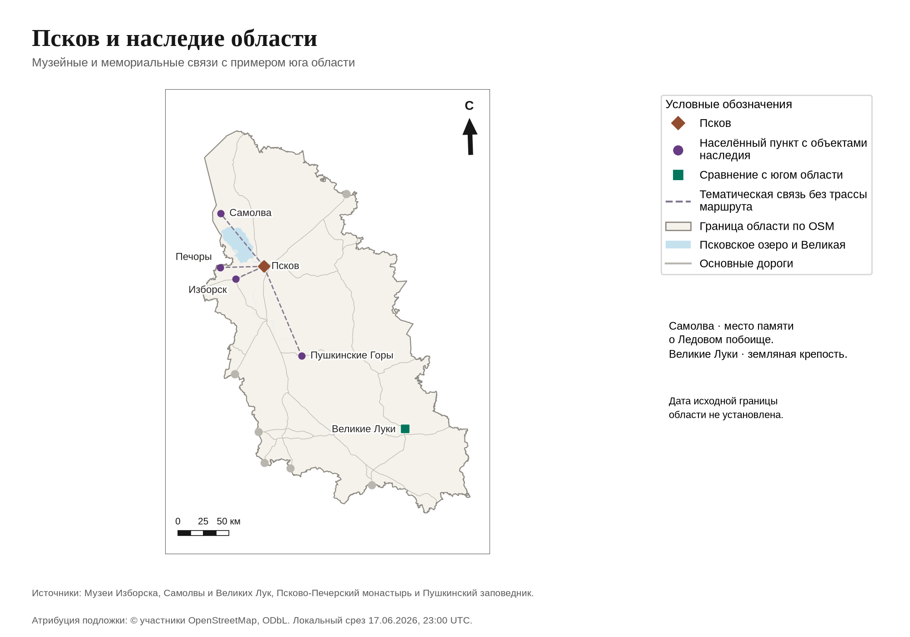
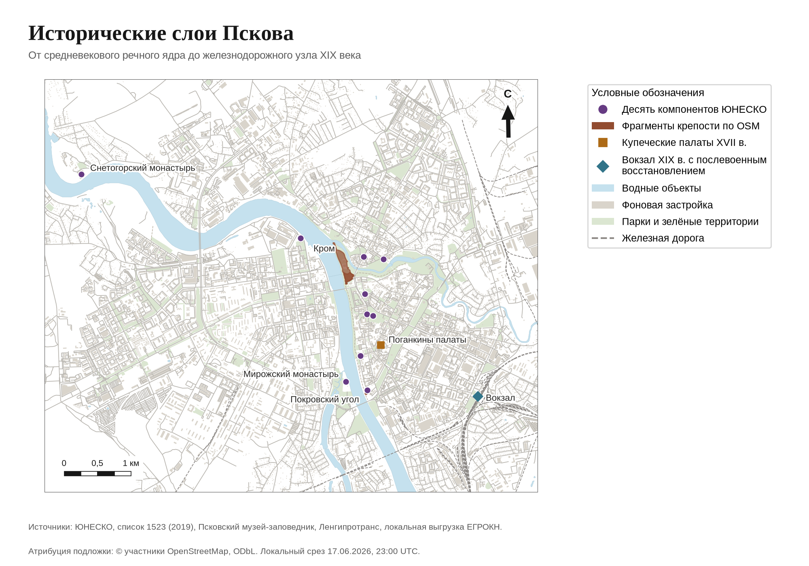
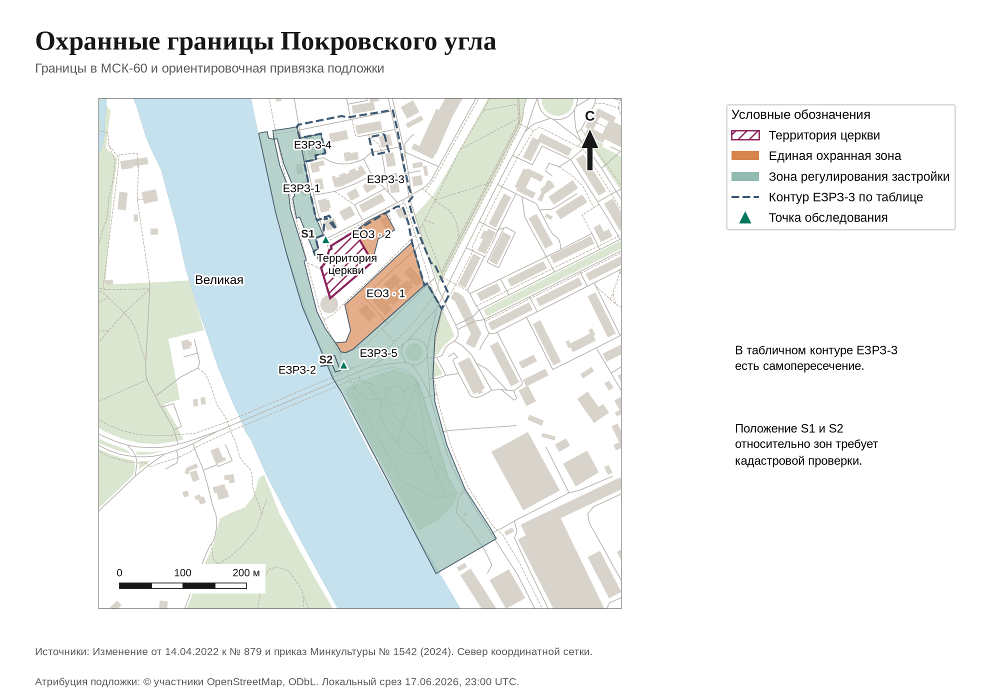
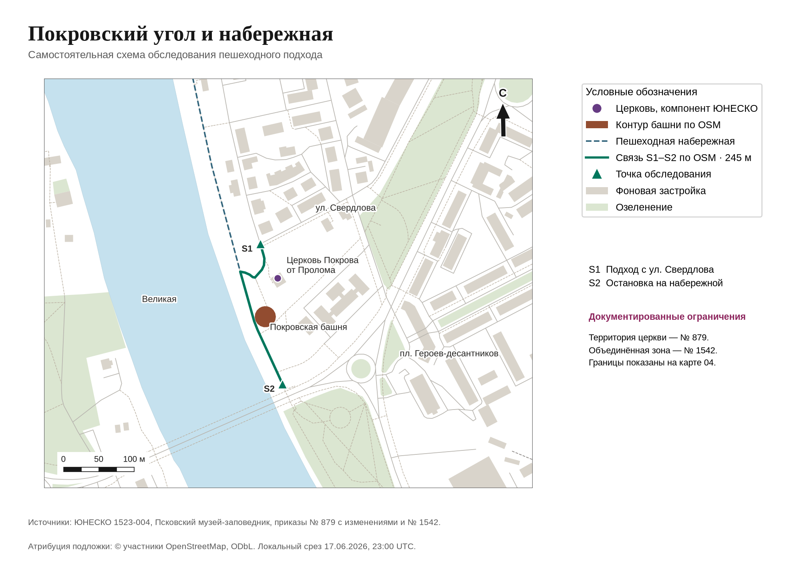

# Историко-культурное наследие Пскова

Исследовательский блок по микроурбанистике. 24 ноября 2026 года.

Псков рассматривается в трёх масштабах: область, исторический город и пешеходный подход к Покровскому углу. Главный вопрос исследования — какие элементы наследия формируют сегодняшнюю среду и как это учитывать при выборе места для навигации и обзорной остановки.

У слияния Великой и Псковы положение Крома и Довмонтова города объясняет связь укреплений с речным рельефом. У южной части Окольного города эта связь читается на уровне пешехода: берег, башня и церковь образуют три близких ориентира. В Полонище другую роль играют купеческие палаты: доступ к музейному комплексу организован внутри городской застройки. Эти два случая требуют разной организации подходов и ориентации.

[Псковский кремль](https://museumpskov.ru/locations?slug=ansambl_pskovskogo_kremlya) · [Поганкины палаты](https://museumpskov.ru/locations?slug=pogankiny_palaty).

Исследование объединяет документальные сведения, локальную сверку ЕГРОКН и картографию OSM. В городской округ по координатам отобрана 301 запись локальной выгрузки с уникальным реестровым номером. Отдельный GeoPackage дал 435 точек, 438 полигонов и 22 записи зон. Из-за различий состава и единиц учёта эти значения используются для проверки источников. Карты показывают документально подтверждённые примеры.

Для Покровского угла подготовлена собственная схема с двумя точками обследования и координатная схема охранных границ. Вывод исследования — сохранить читаемость связки «улица — укрепления — берег» и проверить возможности ориентации и обзора на существующих путях.

## Псков и наследие области

Изборск и Печоры раскрывают крепостную и монастырскую историю региона. Пушкинские Горы представляют музейный ландшафт, а Самолва — историю изучения Ледового побоища и память о нём. Пунктир на карте связывает темы. Координаты показывают населённые пункты. Великие Луки выделены как южный пример для сравнения: земляная крепость начала XVIII века используется городским краеведческим музеем. Этот пример показывает, что крепостная история региона шире западного кластера Псков — Изборск — Печоры.

[Изборский музей-заповедник](https://museum-izborsk.ru/) · [Псково-Печерский монастырь](https://ppmon.ru/o-monastyre/istoriya/) · [Пушкинский заповедник](https://pushkinland.ru/) · [Музей Ледового побоища](https://самолва.рф/about) · [Великолукская крепость](https://muzeumvl.ru/catalog/obekt-kulturnogo-naslediya-federalnogo-znacheniya-zemlyanaya-krepost-postroennaya-po-prikazu-petra-i-v-1704-1708-gg-v-svyazi-s-opasnostyu-vtorzheniya-vojsk-korolya-karla-xii)

## Исторические слои города

Средневековую школу представляют десять компонентов серийного объекта ЮНЕСКО. На Полонище Поганкины палаты показывают купеческий масштаб XVII века. Документальная съёмка 1946 года зафиксировала разрушение части корпуса, а музей датирует восстановление его северной части 1949–1952 годами. Вокзал отмечает отдельный узел XIX века, восстановленный после войны. В Покровском углу работы В. П. Смирнова вернули башне каменный объём и деревянный шатёр.

[Координаты ЮНЕСКО](https://whc.unesco.org/en/list/1523/maps/) · [Фотофиксация 1946 года](https://archaeolog.ru/media/periodicals/aippz/AIPPZ-33-redu.pdf) · [Псковский музей о Смирнове](https://museumpskov.ru/news/k_100_letiyu_vsevoloda_smirnova) · [Проект восстановления вокзала](https://lgt.ru/projects/vokzaly-transportno-peresadochnye-uzly/vokzal-pskov)

## Городская идентичность и планировка

На средневековый Псков указывают укреплённое ядро, Довмонтов город и храмы по обе стороны рек. Псковская вечевая республика утратила самостоятельность в 1510 году. Балтийская торговля связывала город с ганзейскими центрами, а Ганзейские дни 2019 года стали современным культурным событием. Купеческое Полонище раскрывает самостоятельный пласт городской истории через палаты и их музейное использование. [Коллекция Президентской библиотеки](https://www.prlib.ru/collections/1935365) · [Исследование ганзейской торговли](https://archaeolog.ru/media/periodicals/aippz/AIPPZ_36.pdf) · [Псковский музей о Ганзейских днях](https://www.museumpskov.ru/news/2174)

Для современных культурных маркеров важна точная привязка. Скульптура «Скобарь» представляет собирательный образ псковича. У прозвища несколько версий происхождения. У Покровского угла площадь Героев-десантников и её памятный знак добавляют к оборонному ландшафту пласт современной памяти. [Скульптура «Скобарь»](https://ticpskov.ru/places/chto-posmotret/skobar/) · [Версии происхождения слова](https://pskoviana.ru/home1/soccer/317-pskovskie-pyatnitsy/pskovskie-pyatnitsy-dokumenty/3740-poishchem-skobarya-v-slovaryakh) · [Памятный знак на площади](https://old.bibliopskov.ru/15let_desant.htm)

Два участка дают разный результат. У Покровского угла стены и берег разделяют уровни подхода. В Полонище вход в музейный комплекс связан с улицей Некрасова, а объёмы палат лучше читаются в масштабе квартала и двора. Снимки 1946 года фиксируют разрушенную часть корпуса и разобранное крыльцо. Современный музей подтверждает восстановление северной части. В 2026 году соседние палаты Меншиковых вошли в состав музея. Заявленное общественное пространство остаётся планом. [Снимки 1946 года, рис. 1–2](https://archaeolog.ru/media/periodicals/aippz/AIPPZ-33-redu.pdf) · [Карточка Поганкиных палат](https://museumpskov.ru/locations?slug=pogankiny_palaty) · [Палаты Меншиковых](https://www.museumpskov.ru/news/palaty_menshikovyh_stali_obektom_pskovskogo_muzeya_zapovednika)

Псковский драмтеатр сохраняет культурную функцию Народного дома 1906 года. Современная перестройка комплекса добавила мастерские и залы в новом корпусе рядом с историческим зданием. [Драмтеатр о реконструкции](https://drampush.ru/about/reconstruction).

## Планирование и связи с областью

Макет Баранова и Наумова 1945 года показывает проект послевоенной планировки центра. Проект Ю. П. Спегальского предлагал охранять памятники вместе с окружением. Генеральный план города утверждён в 2010 году и менялся, в том числе в 2023 году. На региональном уровне сверены схема территориального планирования в редакции 2025 года и стратегия до 2035 года с изменениями 2026 года. [Макет, с. 93](https://www.maca.ru/attach/catalog/v_1934_118.pdf) · [Проект Спегальского](https://archaeolog.ru/media/periodicals/arch-arch/aa_05.pdf) · [Генплан Пскова](https://base.garant.ru/16750938/) · [СТП области](https://base.garant.ru/411920942/973094d321052bca8aaa4cf4deba6685/) · [Изменения областной стратегии](https://base.garant.ru/415154969/)

Стратегия Пскова до 2030 года связывает наследие с культурно-познавательным туризмом. Турсхема ВЭБ.РФ выделяет связку Псков — Изборск — Печоры и предлагает развивать точки притяжения на юге области. Это исследовательские и стратегические ориентиры. Факт реализации для нашего участка подтверждается отдельно: городской отчёт фиксирует завершение благоустройства набережной между Ольгинским мостом и мостом 50-летия Октября. [Стратегия города](https://fu.pskovadmin.ru/strategic_planning_documents/strategia) · [Турсхема ВЭБ.РФ, этап 1, печатные с. 45–46](https://www.veb.ru/turisticheskie-skhemy/) · [Городской отчёт](https://www.pskovgorod.ru/files/files_2015/1A/otchet_glavy_2015.pdf)

В городском округе Псков на 1 января 2024 года жило 187 129 человек, в области 581 147. Округ концентрировал 32,2% жителей региона. Вокзал, аэропорт Кресты и западный дорожный коридор к Шумилкино задают точки входа на разных масштабах. Для обследуемого участка измерена длина связи S1–S2 по сети OSM. [Псковстат](https://60.rosstat.gov.ru/storage/mediabank/SVOD251230_2.pdf) · [Шумилкино, Росгранстрой](https://www.rosgranstroy.ru/checkpoints/369) · [Аэродром Псков Кресты](https://aip.rossiya-airlines.com/Russia/Disk1/aip/ad/ad2/rus/uloo/1-ad2-rus-uloo-txt.pdf)

## Охранные границы Покровского угла

Для территории церкви применена таблица координат от 14.04.2022 к приказу № 879. Площадь построенного контура 4 497,77 м². Схема 2014 года относится к первоначальной границе площадью 1 194 м². Отдельная объединённая зона церкви и башни по приказу № 1542 содержит два участка ЕОЗ и пять подзон ЕЗРЗ. В контуре ЕЗРЗ-3 есть самопересечение.

[Описание границы в редакции 2020 года](https://base.garant.ru/74432270/89300effb84a59912210b23abe10a68f/) · [Приказ № 1542, карта, координаты и режимы](https://rulaws.ru/acts/Prikaz-Minkultury-Rossii-ot-13.08.2024-N-1542/)

## Собственная схема обследования

В срезе OSM между S1 и S2 есть связанный пешеходный путь длиной около 245 м. Городские отчёты фиксируют реконструкцию и завершение благоустройства набережной от Ольгинского моста до моста 50-летия Октября.

**S1 · Подход с улицы Свердлова.** Проверить, где туристический указатель помогает найти церковь, башню и берег. До выбора места измерить ширину и уклон прохода, оценить вид на два храма и проверить режим участка.

**S2 · Набережная.** Проверить возможность остановки с видом на башню на существующем покрытии. Сохранить непрерывность прохода. Приоритет — обозначение точки обзора, если его достаточно для ориентации.

[Сегмент улицы Свердлова](https://www.openstreetmap.org/way/947627667) · [Пешеходный сегмент набережной](https://www.openstreetmap.org/way/31312852) · [Отчёт главы города 2014–2015](https://www.pskovgorod.ru/files/files_2015/1A/otchet_glavy_2015.pdf)

## Условия выбора решений

**Покровский угол.** Для указателей приказ № 1542 устанавливает разные условия в зависимости от подзоны. В ЕОЗ и ЕЗРЗ-5 предельная высота ориентирующего указателя составляет 3 м. В ЕЗРЗ-5 предусмотрено сохранение планировки набережной и спусков. Приоритет для обследования — сохранить проход и панораму, затем оценить необходимость отдельной конструкции. Для точки установки нужны натурный осмотр и подтверждённое наложение границ. [Приказ № 1542, пп. 1.8, 11.1 и 11.7](https://rulaws.ru/acts/Prikaz-Minkultury-Rossii-ot-13.08.2024-N-1542/).

**Полонище.** У Поганкиных палат проверить, читается ли музейный вход с улицы Некрасова и как по пути воспринимаются объёмы палат. Сопоставить входы и виды с музейной фотофиксацией. Если вход трудно найти, проработать указатель на подходе с учётом режима участка и организации посещения. [Музейная карточка](https://museumpskov.ru/locations?slug=pogankiny_palaty) · [Палаты на фото до ремонта 1915 года](https://pskoviana.ru/istoriya/istoriya-pskovskoj-oblasti/2788-iz-istorii-pskovskogo-muzeya-zapovednika).

**Обследование среды.** У S1 передать специалистам по благоустройству отметки о покрытии и путях стока рядом с укреплениями. У S2 проверить водоотвод и состояние прохода на берегу. Трассы сетей и их состояние требуют исходных данных эксплуатирующих организаций.

**Открытые проверки.** Приложение к приказу № 178 от 30.03.2012 содержит утверждённый проект описания предмета охраны церкви. Окончательный акт требует поиска. При обзорном наложении обе точки оказались примерно в 7–8 м от ближайших границ. На такой дистанции для определения режима нужен официальный вектор либо проверка по кадастровым координатам. Обе сценарные точки предназначены для обследования, фактическое состояние проходов и видимость остаются открытыми.

**Локальные источники.** В исследовании использованы скан изменения от 14.04.2022 с таблицей МСК-60, приказ № 879 и его приложения, карта объединённой зоны № 1542 и скан приказа № 178. Контрольные суммы, разбор документов и воспроизводимый расчёт находятся в материалах проекта.
